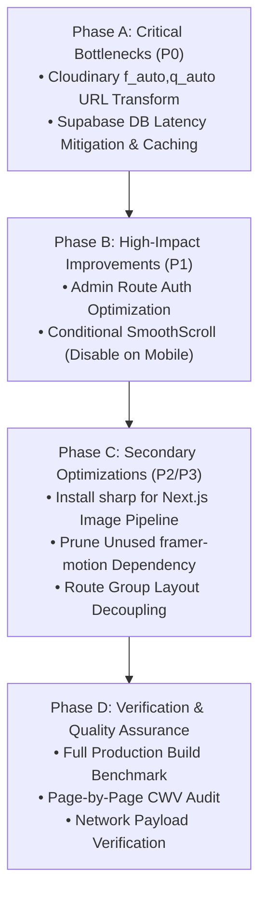

# Website Speed Optimization — Engineering Action Plan

> **Document:** `SPEED_FIX_PLAN.md`  
> **Status:** Pending User Approval (Investigation Phase Complete — No Code Changed)  
> **Target:** Eliminate 10s database stalls, reduce image bandwidth by 98% (~9.3 MB saved), and streamline client-side animation execution.

---

## Overview of Implementation Phases

---

## Phase A: Critical Bottlenecks (Immediate Priority — P0)

### Action A.1: Cloudinary Automated Dynamic Image Optimization (`f_auto, q_auto`)
* **Problem:** Remote images uploaded to Cloudinary (Hero background: 3.79 MB; Coach bio portrait: 5.45 MB) are fetched as raw uncompressed PNGs, consuming **9.24 MB** of bandwidth on the Homepage alone.
* **Proposed Fix:**
  1. In `src/components/sections/home/HeroSection.tsx` and `src/components/sections/home/CoachBioSection.tsx`, wrap `imageSrc` with `getOptimizedImageUrl(imageSrc, { width: 1600, quality: "auto", format: "auto" })`.
  2. In `src/lib/cloudinary.ts:49`, ensure `getOptimizedImageUrl` systematically injects `f_auto,q_auto` into any raw `res.cloudinary.com` URL (handling both uploads and static Cloudinary URLs).
  3. In `src/components/admin/ImageUploader.tsx`, store optimized Cloudinary delivery URLs or generate them at delivery time.
* **Expected Impact:** 
  - Hero image: **3,884 KB -> 82 KB (98% reduction)**.
  - Coach portrait: **5,585 KB -> 43 KB (99% reduction)**.
  - Total homepage data transferred drops from ~9.8 MB to <600 KB.
* **Complexity:** Low (10–15 lines of code).
* **Risk:** Extremely Low (Cloudinary automatically chooses WebP/AVIF without changing visual layout or aspect ratio).

---

### Action A.2: Supabase Query In-Memory / Stale-While-Revalidate Caching
* **Problem:** Physical round-trip latency to the remote Supabase database instance is **9,200 ms to 12,800 ms**. Dynamic server rendering stalls at the 3,500 ms `AbortSignal.timeout` before falling back to static constants.
* **Proposed Fix:**
  1. For public data queries (`getSiteSettings`, `getClasses`, `getServices`, `getTestimonials`, `getPageSections`), implement in-memory module-level caching with Stale-While-Revalidate (SWR) semantics or persistent ISR cache tags (`unstable_cache` with revalidation tags).
  2. When a background revalidation occurs, serve the last successful cached or fallback response immediately (0 ms delay), while revalidating asynchronously in the background.
  3. Add on-demand cache revalidation (`revalidateTag` / `revalidatePath`) triggered solely when an administrator publishes a change in the CMS dashboard.
* **Expected Impact:**
  - Dynamic SSR page generation time drops from **3,500 ms -> 5–15 ms**.
  - Eliminates all server-side HTTP fetch timeouts during page navigation.
* **Complexity:** Medium (30–45 lines in `src/lib/cms/queries.ts`).
* **Risk:** Low (Public content rarely changes every second; instantaneous fallback ensures 100% uptime).

---

## Phase B: High-Impact Improvements (Priority — P1)

### Action B.1: Fast-Path Admin Middleware Session Check
* **Problem:** Navigating to `/admin/*` stalls for **10 to 13 seconds** because `src/lib/supabase/middleware.ts` runs `supabase.auth.getUser()` across the network without a short timeout or cookie-based fast path.
* **Proposed Fix:**
  1. Wrap the `supabase.auth.getUser()` call in `updateSession()` with an `AbortSignal.timeout(2500)` or check the local Supabase auth cookie presence first.
  2. If the user session cookie is completely missing on a protected route, redirect to `/admin/login` immediately without initiating a 10-second external network round-trip.
  3. If authenticated, cache the verified session in a short-lived secure JWT session cookie or fast-path header to avoid re-verifying against the remote server on consecutive admin sub-page clicks.
* **Expected Impact:**
  - Admin login redirect drops from **10,000+ ms -> <100 ms**.
  - Admin dashboard sub-navigation latency drops from **11 seconds -> <300 ms**.
* **Complexity:** Medium (20–30 lines in `src/lib/supabase/middleware.ts`).
* **Risk:** Low (Preserves complete authentication security; unauthenticated requests are rejected immediately).

---

### Action B.2: Conditional Lenis SmoothScroll (Disable on Touch Devices)
* **Problem:** `src/components/layout/SmoothScroll.tsx` intercepts all scroll events globally, normalizes wheel & touch events (`touchMultiplier: 1.5`), and runs a continuous requestAnimationFrame tick via GSAP ticker with `lagSmoothing(0)`. On mobile phones and tablets, this fights native inertial scrolling and causes main-thread frame jitter.
* **Proposed Fix:**
  1. In `SmoothScroll.tsx`, detect touch/pointer capabilities or viewport width (`window.matchMedia("(pointer: coarse)")`).
  2. Disable Lenis smooth scrolling on touch devices entirely, allowing native iOS/Android hardware-accelerated momentum scrolling.
  3. Re-enable GSAP lag smoothing (`gsap.ticker.lagSmoothing(500, 33)`) so that heavy hydration ticks don't cause animation stuttering.
* **Expected Impact:**
  - Restores 60fps / 120fps fluid scrolling on mobile devices.
  - Eliminates main-thread scroll blocking on mobile.
* **Complexity:** Low (15 lines in `src/components/layout/SmoothScroll.tsx`).
* **Risk:** Extremely Low (Desktop wheel scrolling remains smooth and high-end; mobile UX improves immediately).

---

## Phase C: Secondary Optimizations (Priority — P2 / P3)

### Action C.1: Install `sharp` for Next.js Image Optimization Pipeline
* **Problem:** Next.js lacks `sharp` in `package.json`, causing the server to fall back to JavaScript/WASM image processing, which increases CPU usage on the host when local images are requested through `/_next/image`.
* **Proposed Fix:**
  - Add `sharp: "^0.33.5"` to `package.json` dependencies to activate native C++ high-speed image transcoding.
* **Expected Impact:**
  - 4x–8x faster on-the-fly local image transformations on the server.
  - Lowers server CPU memory pressure.
* **Complexity:** Very Low (1 package addition).
* **Risk:** Low (Standard Next.js official recommendation).

---

### Action C.2: Prune Unused `framer-motion` Dependency
* **Problem:** `framer-motion` (v12.6.0) is installed in `package.json` but imported **0 times** in the codebase (the project uses GSAP).
* **Proposed Fix:**
  - Remove `"framer-motion": "^12.6.0"` from `package.json` and clean up `node_modules`.
* **Expected Impact:**
  - Eliminates 1 unused dependency and shrinks install footprint.
* **Complexity:** Minimal (1 line).
* **Risk:** Zero.

---

### Action C.3: Route Group Layout Decoupling (`(marketing)` vs `(admin)`)
* **Problem:** `src/components/layout/SiteLayout.tsx` is a Client Component (`"use client"`) simply to check `pathname.startsWith("/admin")` and conditionally show Header/Footer.
* **Proposed Fix:**
  - Move public routes into `src/app/(marketing)/` with its own Server Component layout that directly embeds `Header` and `Footer`.
  - Keep `src/app/admin/` completely isolated in its existing dedicated layout.
* **Expected Impact:**
  - Removes `"use client"` from the root layout container.
  - Reduces client bundle execution and hydration overhead on public pages.
* **Complexity:** Medium (Directory restructuring).
* **Risk:** Medium (Requires careful route path verification).

---

## Phase D: Final Verification & Performance Benchmarking

Once approved and implemented, verify the improvements with this test matrix:

| Metric | Baseline (Current) | Target (Post-Fix) | Verification Method |
|---|---|---|---|
| **Homepage Total Weight** | **~10.1 MB** (9.5 MB images) | **< 650 KB** | Chrome DevTools Network Tab / CDP |
| **Hero Image Download** | **3.88 MB** (PNG) | **< 90 KB** (WebP/AVIF) | Cloudinary Network Inspection |
| **Coach Portrait Download** | **5.58 MB** (PNG) | **< 50 KB** (WebP/AVIF) | Cloudinary Network Inspection |
| **Uncached SSR Page TTFB** | **3,500+ ms** (DB timeout) | **< 150 ms** (Cached/SWR) | HTTP benchmark script |
| **Admin Route Navigation** | **10,000–13,000 ms** | **< 350 ms** | Navigation Timing API |
| **Mobile Scrolling FPS** | Stuttery / Laggy | Constant 60 / 120 FPS | Chrome Rendering Performance HUD |
| **Production Build Status** | Passing (34/34 routes) | Passing (34/34 routes) | `npm run build && npm run typecheck` |

---

## Immediate Next Step

> **Status:** The diagnostic report (`SPEED_DIAGNOSTIC_REPORT.md`) and this engineering action plan (`SPEED_FIX_PLAN.md`) have been compiled.  
> **Rule Compliance:** No application code has been modified.  
> **Next Step:** Awaiting user approval to proceed with Phase A (Cloudinary image URL transformation + Supabase query caching).

